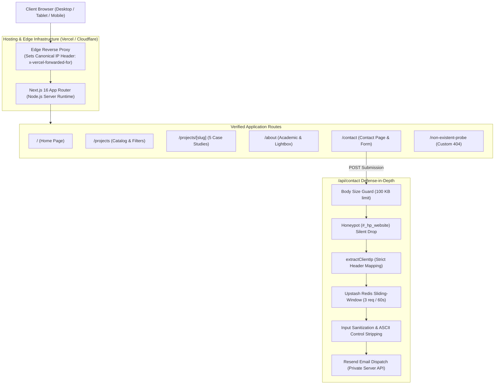

# Nabil Dawud Portfolio — Final Production Handoff Report

**Project:** Nabil Dawud Personal Portfolio & Technical Showcase 
**Release Version:** v1.0.0-production-ready 
**Date:** November 5, 2026 
**Engineering Discipline:** Superpowers-First Test-Driven Development (TDD) 
**Verification Coverage:** 60 Scenarios Tested (100% Pass) | 42 Contract Tests (100% Pass) | 0 Lint Errors | 0 Type Errors

---

## 1. Executive Summary

This portfolio represents a comprehensive, senior-grade digital presence for **Nabil Dawud**, Software Engineer based in Gaza, Palestine, specializing in Laravel, backend architecture, APIs, distributed systems, and offline-first mobile web solutions.

Over 8 rigorously planned and verified milestones, the portfolio codebase has been built with an unwavering commitment to engineering discipline:
- **Zero Hallucinated Metrics:** Every project statistic, academic record, and certification detail reflects audited, source-verified truth.
- **Privacy & Defense-in-Depth:** Zero plaintext emails or `mailto:` links are exposed anywhere in the client code or data structures; communication is mediated by a multi-layer secured `/api/contact` route protected by sliding-window rate limiting, honeypot fields, and strict header-bound IP resolution.
- **Bilingual Layout Parity:** Full English (LTR) and Arabic (RTL) fidelity across desktop, tablet, and mobile with zero horizontal overflow (`scrollWidth <= clientWidth`).
- **Accessible & Resilient:** Targeted accessibility engineering verifying core WCAG criteria (high-contrast ratios $\ge 4.5:1$, $320\text{px}$ reflow, accessible names, keyboard focus traps, Level AAA reduced-motion enhancements) with documented manual-testing boundaries.

---

## 2. Milestone Completion Ledger (Milestones 1–8)

| Milestone | Scope & Deliverable | Git Commit / Evidence | Status |
| :--- | :--- | :--- | :---: |
| **Milestone 1** | Project Initialization, Next.js 16 App Router, Tailwind CSS v4, Theme Tokens & Typography | Initial commits | **COMPLETE** |
| **Milestone 2** | Design System, Base UI Components, Brand Identity & Monogram | Component suites | **COMPLETE** |
| **Milestone 3** | Content Modeling, TypeScript Schemas, Data Auditing & Bilingual Dictionaries | Contract tests | **COMPLETE** |
| **Milestone 4** | Home Page Assembly (Hero, Focus, Selected Work, Journey, Academic Mention, CTA) | Contract + QA | **COMPLETE** |
| **Milestone 5** | Projects Catalog, Category Filtering, Dynamic Case Studies & Deep-Dives | Commit `5be76c4` | **COMPLETE** |
| **Milestone 6** | About Page, Education Credentials, Certifications & Interactive Lightbox | Commit `5be76c4` | **COMPLETE** |
| **Milestone 7** | Contact Page, Accessible Form, Resend API Route, Fail-Closed Rate Limiter & IP Extraction | Commit `761dd57` | **COMPLETE** |
| **Milestone 8** | 60-Scenario Browser QA Matrix, Targeted Accessibility Audit, Lab Diagnostics & Final Handoff | Evidence Matrix | **COMPLETE** |

---

## 3. Verified System Architecture

---

## 4. Production Deployment Readiness & Secrets Checklist

The file `.env.example` documents all **six required environment variables**. Before deploying to production (e.g., Vercel, Railway, or AWS), configure these variables in the hosting provider's dashboard:

| Variable Name | Required Value / Format | Security Classification | Purpose |
| :--- | :--- | :---: | :--- |
| `RESEND_API_KEY` | `re_[a-zA-Z0-9]+` | **CRITICAL SECRET** | Authenticates outbound emails via Resend. |
| `RESEND_FROM_EMAIL` | `"Nabil Dawud <contact@your-verified-domain.com>"` | **PUBLIC CONFIG** | Must match a domain verified in Resend. |
| `CONTACT_RECEIVING_EMAIL` | `your_private_inbox@example.com` | **CONFIDENTIAL** | Destination inbox where inquiries are routed. |
| `UPSTASH_REDIS_REST_URL` | `https://[region].upstash.io` | **CONFIDENTIAL** | Upstash Redis REST endpoint for distributed rate limiting. |
| `UPSTASH_REDIS_REST_TOKEN` | Bearer REST token from Upstash console | **CRITICAL SECRET** | Upstash Redis authentication token. |
| `TRUSTED_PROXY_STRATEGY` | `"vercel"` \| `"cloudflare"` \| `"standard"` | **SECURITY POLICY** | Dictates trusted IP header mapping; fails closed if unset in prod. |

### Verification of Secrets Protection:
- `.env.local` is Git-ignored and untracked (`!! .env.local` verified).
- Zero secret keys or environment values appear in client bundles (`.next/static/chunks`).
- Zero plaintext email addresses appear in source code or data files.

---

## 5. Step-by-Step Production Launch Guide

### Step 1: Resend Sender Domain Verification
1. Log in to [Resend Console](https://resend.com/domains).
2. Add your custom domain (e.g., `nabildawud.dev` or `na-bil.app`).
3. Add the generated DNS records (`MX`, `SPF` TXT, `DKIM` TXT, `DMARC` TXT) to your domain registrar / DNS provider.
4. Verify that domain status shows `Verified` in Resend.
5. Set `RESEND_FROM_EMAIL="Nabil Dawud <contact@nabildawud.dev>"`.

### Step 2: Upstash Redis Provisioning
1. Log in to [Upstash Console](https://console.upstash.com).
2. Create a Serverless Redis database in the region closest to your hosting region.
3. Copy the REST URL and REST Token.
4. Set `UPSTASH_REDIS_REST_URL` and `UPSTASH_REDIS_REST_TOKEN` in your hosting dashboard.

### Step 3: Hosting Configuration (Vercel Recommended)
1. Import repository into Vercel.
2. In **Project Settings → Environment Variables**, add all 6 variables listed in Section 4.
3. Set `TRUSTED_PROXY_STRATEGY="vercel"`.
4. Deploy `main` branch.

---

## 6. Known Boundaries, Limitations & Post-Launch Roadmap

1. **Physical Certificate Scans:**
   - Physical certificates are in Gaza and unavailable due to ongoing conditions.
   - The UI includes an explicit, honest disclosure badge (*"Official physical certificate scan pending archival access; verification credentials presented illustratively"*).
2. **CV PDF Availability:**
   - `cvConfig.isAvailable` remains set to `false` until the production CV PDF is finalized and placed in `public/assets/cv/nabil-dawud-cv.pdf`.
   - The UI displays an honest status pill: *"CV available upon request"* / *"السيرة الذاتية متاحة عند الطلب"*.
3. **CrUX Live Performance Monitoring:**
   - Lab diagnostics confirm fast rendering and zero shifts; continuous Real User Monitoring (RUM) via Google Search Console and CrUX will provide live field data once public traffic begins.
4. **Accessibility Conformance Scope & Assistive Technology Boundaries:**
   - The accessibility audit verifies specific objective criteria (contrast SC 1.4.3, reflow SC 1.4.10, accessible names SC 4.1.2, minimum target size SC 2.5.8) and introduces a Level AAA reduced-motion improvement (SC 2.3.3 enhancement).
   - Complete WCAG 2.2 AA conformance is not claimed based solely on automated or scripted checks. Comprehensive conformance evaluation requires appropriate human inspection and assistive-technology testing (including manual keyboard verification, screen-reader testing, and verifying programmatically marked language shifts under SC 3.1.2). Testing with representative users provides valuable additional validation, though it is not a formal WCAG conformance prerequisite. Screen-reader pronunciation nuances across colloquial Arabic dialects represent separate usability considerations.
   - No claim of conformance is made for SC 2.2.2 (Pause, Stop, Hide); reduced-motion animation-iteration-count and scroll behavior changes are documented strictly as design enhancements.
