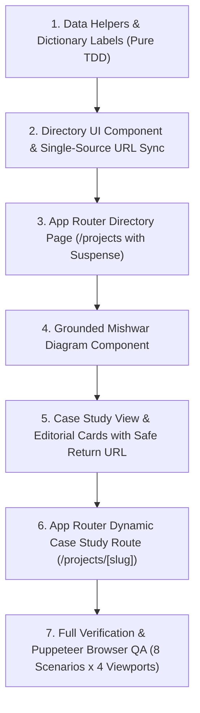

# Milestone 5 — Task 2: Projects Directory UI & Dynamic Case Studies Plan (Final Revision v2)

> **For agentic workers:** REQUIRED SUB-SKILL: Use superpowers:executing-plans to implement this plan task-by-task. Steps use checkbox (`- [ ]`) syntax for tracking.

**Goal:** Build the complete bilingual Projects Directory (`/projects`) with accessible, single-source-of-truth URL-synced category filtering and dynamic Case Study pages (`/projects/[slug]`) featuring structured editorial technical cards, verified links, safe directory context preservation on return, and a grounded 3-concern architecture diagram for Mishwar.

**Architecture:** 
- Next.js App Router static pre-rendering via `generateStaticParams()` for all five verified project slugs (`meshwar`, `masar`, `apartment-marketplace`, `orbit`, `university-issues`).
- Dynamic SEO metadata generation via `generateMetadata()` awaiting Next.js 16 async `params` (`const { slug } = await params;`) with localized titles, descriptions, and canonical URLs.
- **Single Source of Truth URL Filtering:** The active category is derived directly from Next.js `useSearchParams().get("category")` with zero competing `useState` and zero manual `popstate` listeners. Next.js App Router native History API integration (`window.history.pushState`) automatically synchronizes `useSearchParams()`.
- Safe directory context preservation: navigating to a case study preserves the active filter via allowlisted `?from=${category}`. Case study "Back to Projects" restores the exact previous filter (including clean `/projects` for "All"). Direct external visits safely fall back to clean `/projects`.
- Structured editorial technical cards template for case studies powered directly by the approved bilingual data model in `src/data/projects.ts` (zero hardcoded editorial copy inside React components).
- Selective, strictly verified visual diagram for Mishwar separated into 3 clear engineering concerns: (1) Offline Routing Architecture, (2) Live Location Data Flow with explicit elapsed age indicators (omitting arbitrary numerical distance thresholds), and (3) Deployment & Testing Environment.

**Tech Stack:** Next.js 16.4.5 (App Router, Turbopack), React 19.3.1, TypeScript 5, Tailwind CSS v4, Lucide React 1.69.0, Node.js built-in test runner (`tsx --test`), Puppeteer Core.

**Spec:** `nabil-dawud-portfolio-master-plan.md` (Consolidated Portfolio Specification Final v4, Section 4 & Section 9.5).

---

## 1. Case Study Content Architecture

All case study content is data-driven, typed, and sourced directly from [`src/data/projects.ts`](file:///D:/ai-projects/Portfolio/src/data/projects.ts) using the existing [`Project`](file:///D:/ai-projects/Portfolio/src/data/types.ts) interface. No React component contains hardcoded project facts.

### Section-to-Data Mapping

| Case Study Section | Field in `Project` Interface | Data Type | Notes |
| :--- | :--- | :--- | :--- |
| **1. Overview & Context** | `project.overview` | `Localized<string>` | High-level engineering narrative and Gaza / domain context. |
| **2. Problem & Objectives** | `project.problem`<br>`project.solution` | `Localized<string>`<br>`Localized<string>` | Two-part structure: the concrete infrastructure/operational problem and the technical solution. |
| **3. Role & Contributions** | `project.role`<br>`project.ownership`<br>`project.verifiedHighlights` | `Localized<string>`<br>`Localized<string>`<br>`Localized<string[]>` | Strictly separates individual ownership (Mishwar, University Issues, Apartment Maintenance) from team roles (Masar, Orbit). Itemizes verified contributions. |
| **4. Architecture & Decisions** | `project.architectureHighlights`<br>`MishwarArchitectureDiagram` | `Localized<string[]>`<br>Component | Structured bullet points of key architectural decisions. For Mishwar only, embeds the selective 3-concern diagram. |
| **5. Key Features Scope** | `project.keyFeatures` | `Localized<string[]>` | Checkmarked list of implemented and verified capabilities. |
| **6. Challenges & Lessons** | `project.challenges`<br>`project.lessonsLearned` | `Localized<string[]>`<br>`Localized<string[]>` | Two-column responsive comparison of real technical obstacles overcome and engineering principles learned. |
| **7. Technology Stack** | `project.techStack` | `string[]` | Clean monospace tags of verified frameworks, runtimes, and libraries. |
| **8. Source & Demo Links** | `project.links` | `ProjectLinks` | Live demo, GitHub repository (or locked badge if private), and CI/CD pipeline link. |
| **9. Verification Boundaries** | `project.disclaimers` | `Localized<string[]>` (optional) | Transparent disclaimers regarding repository privacy, demo availability, or AI-assisted workflow. |

*Finding:* The existing `Project` interface in `src/data/types.ts` and data in `src/data/projects.ts` already cover 100% of these sections. No new data files or schema modifications are required.

---

## 2. Single Source of Truth URL Filtering & Navigation Strategy

### A. Canonical Category Source of Truth
In `src/data/projects-helpers.ts`:
```typescript
export const ALLOWED_CATEGORIES = [
  "flagship",
  "backend-api",
  "fullstack",
  "academic",
] as const;

export type FilterCategory = (typeof ALLOWED_CATEGORIES)[number] | "all";

export function isValidCategory(category: unknown): category is FilterCategory {
  return (
    typeof category === "string" &&
    (category === "all" || (ALLOWED_CATEGORIES as readonly string[]).includes(category))
  );
}

export function getSafeBackUrl(fromParam: string | null): string {
  if (fromParam && (ALLOWED_CATEGORIES as readonly string[]).includes(fromParam)) {
    return `/projects?category=${fromParam}`;
  }
  return "/projects";
}
```

### B. Single Source of Truth — Zero Competing State
1. **Derive Category Directly from URL:**
   Inside `ProjectsDirectoryContent.tsx`:
   ```typescript
   const searchParams = useSearchParams();
   const rawCategory = searchParams.get("category");
   const activeCategory: FilterCategory = isValidCategory(rawCategory) ? rawCategory : "all";
   ```
   - **No `useState`:** There is no separate local state that could ever diverge from the URL.
   - **No manual `popstate` listener:** Next.js App Router native History API integration automatically synchronizes `useSearchParams()` when `window.history.pushState` or browser Back/Forward runs.
2. **Filter Selection Updates the URL:**
   ```typescript
   const handleFilterChange = (category: FilterCategory) => {
     const nextUrl = category === "all" ? "/projects" : `/projects?category=${category}`;
     window.history.pushState(null, "", nextUrl);
   };
   ```
   - Selecting a category sets `/projects?category=<allowed-category>`.
   - Selecting `"all"` removes the query parameter cleanly to `/projects`.
3. **Preserving Filter Context When Navigating to Case Studies (`?from=`):**
   - In `ProjectsDirectoryContent.tsx` / `ProjectCard`:
     - When `activeCategory !== "all"`, project cards link to `/projects/${project.slug}?from=${activeCategory}`.
     - When `activeCategory === "all"`, project cards link to `/projects/${project.slug}`.
   - In `CaseStudyHeader.tsx`:
     - The "Back to Projects" button uses `getSafeBackUrl(searchParams.get("from"))`.
     - If `from === "flagship"`, returns to `/projects?category=flagship`.
     - If `from` is missing, invalid, or was `"all"`, safely returns to clean `/projects`.
     - Arbitrary user URLs are never used as navigation destinations; only allowlisted categories are mapped.
   - In `CaseStudyNav.tsx`:
     - Previous and Next case study links preserve `?from=${fromParam}` so browsing between case studies retains the user's origin filter context.
4. **Accessible ARIA Semantics:**
   - Semantic button group: `<div role="group" aria-label="Project category filters">`.
   - Buttons use `<button aria-pressed={activeCategory === cat}>`.
   - Standard `Tab` and `Enter`/`Space` keyboard navigation.

---

## 3. Verified Mishwar Diagram Scope

Based on direct inspection of `D:\ai-projects\meshwar\app\Services\RouteDriftService.php` and `tests\Feature\Milestone5Test.php`:
- `RouteDriftService.php` contains `protected const DRIFT_BUFFER_METERS = 1000.0;` and alerts `'المركبة غيرت مسارها حالياً — اضغط للاتصال بالسائق'`.
- To avoid arbitrary numerical distance claims in the portfolio, the diagram **omits** the `>1000m` numerical value and describes the concept cleanly as:
  *"Route drift detection comparing real-time vehicle GPS against corridor stops, alerting passengers if a vehicle deviates from its scheduled path."*

### The 3 Visual Concerns in `MishwarArchitectureDiagram.tsx`:
1. **Offline Routing Architecture (المخطط بدون إنترنت):**
   - Client-cached in-memory transit graph for Gaza corridors (Salah al-Din, Coastal road).
   - Local multi-leg itinerary search computed entirely in client JavaScript.
   - *Clear scope boundary:* Applies strictly to route graph search; live tracking, bidding, and messaging require active cellular connectivity.
2. **Live Location Data Flow (تتبع المواقع ومؤشرات الحداثة):**
   - Real-time vehicle positions synchronized when cellular connectivity is available.
   - Human-readable GPS Data Freshness Indicators displaying elapsed age (e.g. *"آخر موقع: دوار الكويت، منذ 3 دقائق"* / *"Last location: Kuwait Roundabout, 3 mins ago"*).
   - Route drift detection and direct dialer coordination.
3. **Deployment & Testing Environment (بيئة التشغيل والنشر):**
   - Application Server: FrankenPHP / Caddy worker runtime on PHP 8.4.
   - Isolated Test Harness: In-memory SQLite suite replicating MySQL production constraints in automated GitHub Actions CI.
   - Continuous deployment to Dokku.

---

## 4. Testing & Verification Strategy

### A. Node.js Contract Tests (Run via `npm test` / `tsx --test`) — 3 Files
1. `tests/projects/data-helpers.contract.test.ts`:
   - Validates `getAllProjects()`, `getProjectBySlug(slug)`, `getAdjacentProjects(slug)`, `filterProjectsByCategory(cat)`, and `isValidCategory(cat)`.
   - Validates `getSafeBackUrl(fromParam)` allowlist security (valid category returns `/projects?category=${cat}`, invalid or malicious string returns clean `/projects`).
   - Tests unknown slug returns `undefined`.
   - Tests adjacent project navigation at boundaries (first and last project do not throw).
2. `tests/projects/directory-filtering.contract.test.ts`:
   - Validates category parsing and fallback to `"all"` for unknown values.
   - Validates project counts per category (`all: 5`, `flagship: 2`, `backend-api: 1`, `fullstack: 1`, `academic: 1`).
   - Validates that Mishwar has the flagship prominence flag.
   - Validates that project cards link to `/projects/[slug]` (with `?from=` when filtered).
3. `tests/projects/case-study-route.contract.test.ts`:
   - Validates `generateStaticParams()` returns exactly the 5 canonical slugs.
   - Validates `generateMetadata()` generates localized titles, descriptions, and canonical URLs.
   - Validates Next.js 16 async `params` contract (`await params`).
   - Validates 404 behavior for unknown slugs.

### B. Headless Chrome Puppeteer QA Script — 1 Script
[`tests/browser-qa-projects.mjs`](file:///D:/ai-projects/Portfolio/tests/browser-qa-projects.mjs) executes **8 functional browser interaction scenarios** across **4 responsive/language viewport configurations**:

#### **8 Functional Interactive Scenarios:**
1. **Direct Filtered URL Loading:** Navigating directly to `http://localhost:3000/projects?category=backend-api` loads with only Orbit visible and the "Backend & APIs" button showing `aria-pressed="true"`.
2. **Filter Switching & URL Query Sync:** Clicking "Flagship" updates URL to `?category=flagship` (2 cards displayed); clicking "All" removes the query parameter (`/projects`) and displays 5 cards.
3. **Browser Back & Forward Navigation:** After switching filters, `page.goBack()` restores `?category=flagship`; `page.goForward()` restores `/projects`.
4. **Page Refresh Persistence:** Reloading `/projects?category=academic` retains University Issues Management.
5. **Return from Case Study (Filter Preservation):** Navigating from `/projects?category=fullstack` into `/projects/apartment-marketplace?from=fullstack` and clicking "Back to Projects" safely restores `/projects?category=fullstack`.
6. **Direct Case Study Entry Safe Fallback:** Navigating directly to `/projects/meshwar` without a `?from=` parameter and clicking "Back to Projects" safely routes to clean `/projects`.
7. **Invalid Category Fallback:** Navigating to `http://localhost:3000/projects?category=malicious-or-unknown` safely renders All 5 projects without runtime errors or blank states.
8. **Keyboard Accessibility & Focus:** Tabbing through filter buttons verifies visible focus rings, `aria-pressed` states, and `Enter`/`Space` activation.

#### **4 Responsive & Language Viewport Configurations:**
1. **English Desktop (1440×900, LTR):** Full catalog grid, interactive filter bar, `/projects/meshwar` case study layout and diagram.
2. **English Mobile (390×844, LTR):** Mobile filter pill row, responsive single-column cards, `/projects/masar` mobile layout.
3. **Arabic Desktop (1440×900, RTL):** Arabic typography (`Alexandria`, `IBM Plex Sans Arabic`), Arabic filter group, `/projects/meshwar` Arabic diagram, and flipped back arrow.
4. **Arabic Mobile (390×844, RTL):** Mobile RTL case study, verified zero horizontal overflow (`scrollWidth <= clientWidth`), and screenshot captures.

---

## 5. Exact Create / Modify File List

### Files to Create (10 files)
1. `src/data/projects-helpers.ts` — Pure helper functions (`getProjectBySlug`, `getAdjacentProjects`, `filterProjectsByCategory`, `isValidCategory`, `getSafeBackUrl`, `getCategoryCount`).
2. `src/components/projects/ProjectsDirectorySkeleton.tsx` — Lightweight skeleton fallback for Suspense.
3. `src/components/projects/ProjectsDirectoryContent.tsx` — Client component with accessible filter group (`aria-pressed`), single source of truth URL sync, and responsive project grid.
4. `src/components/projects/MishwarArchitectureDiagram.tsx` — Grounded 3-concern diagram (offline routing, live telemetry, and deployment infrastructure).
5. `src/components/projects/CaseStudyHeader.tsx` — Breadcrumbs with safe return URL, category/status badges, title, tagline, role pill, action ribbon.
6. `src/components/projects/CaseStudyNav.tsx` — Previous / Next case study switcher preserving origin filter context.
7. `src/components/projects/CaseStudyView.tsx` — Structured editorial technical cards template.
8. `src/components/projects/index.ts` — Barrel exports.
9. `src/app/projects/page.tsx` — Directory route wrapping `<ProjectsDirectoryContent />` in `<Suspense>` with static metadata.
10. `src/app/projects/[slug]/page.tsx` — Dynamic case study route with `generateStaticParams()` and `generateMetadata()`.

### Files to Modify (2 files — Dictionary Extensions Only)
1. `src/i18n/dictionaries/en.ts` — Add helper labels (directory header, diagram titles, next/prev navigation).
2. `src/i18n/dictionaries/ar.ts` — Add Arabic helper labels.

### Test Files to Create (4 files)
1. `tests/projects/data-helpers.contract.test.ts` (Node contract test)
2. `tests/projects/directory-filtering.contract.test.ts` (Node contract test)
3. `tests/projects/case-study-route.contract.test.ts` (Node contract test)
4. `tests/browser-qa-projects.mjs` (Puppeteer browser interaction & visual QA script)

---

## 6. Execution Order & Dependencies



---

## 7. Out of Scope

- Remote Git pushing (`git push`) or remote cloud deployments.
- Committing code without explicit user authorization.
- Modifying project data in `src/data/projects.ts` (Task 1 is closed).
- Milestone 6 deliverables: About page, university degree deep-dive, Tawjihi 99.1% highlight, certificate gallery, and image lightbox.
- Milestone 7 deliverables: Contact form page (`/contact`), Resend API integration, spam protection, and rate limiting.
- Speculative architectural diagrams for projects other than Mishwar.
- Fabricated numerical drift or freshness thresholds.
